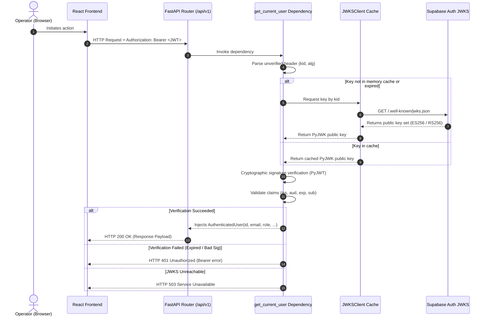

# DATAVERSE — Backend JWT Authentication & JWKS Validation Architecture

## Overview

The DATAVERSE FastAPI backend service secures all protected REST endpoints using asymmetric **JSON Web Key Set (JWKS)** cryptographic verification against **Supabase Auth**.



---

## 1. Cryptographic Design & Invariants

1. **Asymmetric Public-Key Verification**:
   - The backend service does not require, store, or share any private key or Supabase service-role secret.
   - Verification uses the official public JWKS endpoint:  
     `https://<project-ref>.supabase.co/auth/v1/.well-known/jwks.json`.
   - The Supabase project currently signs tokens using **ES256** (ECDSA with P-256 curve and SHA-256). **RS256** is also supported as a fallback.
2. **Never Trust Unverified Claims**:
   - JWT headers are parsed only to extract `alg` and `kid`.
   - Claims (`sub`, `iss`, `aud`, `exp`) are inspected **only after** cryptographic signature verification passes.
3. **Audience & Issuer Enforcement**:
   - `iss`: Must strictly match `SUPABASE_JWT_ISSUER` (`https://<project-ref>.supabase.co/auth/v1`).
   - `aud`: Must strictly match `SUPABASE_JWT_AUDIENCE` (`authenticated`).
   - `exp`: Tokens past expiration are rejected with HTTP 401.
4. **Resilient Key Caching & Dynamic Refresh**:
   - Retrieved keys are cached in-memory with a 300-second TTL to eliminate network latency on hot paths.
   - When an unrecognised `kid` is presented, `JWKSClient` triggers a single cache refresh to accommodate Supabase key rotation.
   - If the identity provider cannot be contacted, the service fails safely by returning **HTTP 503 Service Unavailable** rather than permitting unverified traffic.

---

## 2. Configuration & Environment Variables

All settings are managed via `backend/app/core/config.py` using Pydantic Settings, loaded from the project root `.env`:

| Environment Variable    | Default Value                                   | Description                                |
| :---------------------- | :---------------------------------------------- | :----------------------------------------- |
| `SUPABASE_URL`          | `https://your-project-id.supabase.co`           | Base URL of the Supabase project           |
| `SUPABASE_JWT_ISSUER`   | `${SUPABASE_URL}/auth/v1`                       | Expected `iss` claim in incoming JWTs      |
| `SUPABASE_JWKS_URL`     | `${SUPABASE_URL}/auth/v1/.well-known/jwks.json` | Public JWKS endpoint                       |
| `SUPABASE_JWT_AUDIENCE` | `authenticated`                                 | Expected `aud` claim for operator sessions |
| `JWT_ALGORITHMS`        | `["ES256", "RS256"]`                            | Permitted asymmetric signing algorithms    |

---

## 3. Reusable FastAPI Dependencies

Located in `backend/app/api/deps.py`:

### Usage Example:

```python
from fastapi import APIRouter, Depends
from backend.app.api.deps import get_current_user
from backend.app.schemas.auth import AuthenticatedUser

router = APIRouter()

@router.get("/protected-endpoint")
async def protected_route(
    current_user: AuthenticatedUser = Depends(get_current_user),
):
    return {
        "operator_id": str(current_user.id),
        "email": current_user.email,
    }
```

---

## 4. Protected Endpoints

### `GET /api/v1/auth/me`

Returns the verified operator's public identity:

- **Headers Required**: `Authorization: Bearer <valid_jwt>`
- **Response Format (HTTP 200)**:
  ```json
  {
    "id": "11111111-1111-1111-1111-111111111111",
    "email": "operator@dataverse.io",
    "role": "authenticated",
    "user_metadata": {
      "display_name": "Test Operator"
    },
    "authenticated": true
  }
  ```
- **Error Responses**:
  - `401 Unauthorized`: Missing or malformed header, invalid signature, expired token.
  - `503 Service Unavailable`: Identity provider JWKS service unreachable.

---

## 5. Integration with PostgreSQL Database Transactions & RLS

When an authenticated route handler accesses the database:

1. `get_current_user` extracts and verifies the bearer token via JWKS.
2. `get_db_transaction` receives the verified `AuthenticatedUser` model.
3. It opens an isolated transaction on an `asyncpg` pooled connection.
4. Transaction-local configuration is set:
   ```sql
   SELECT set_config('request.jwt.claim.sub', $1, true);
   SELECT set_config('request.jwt.claim.role', $2, true);
   SET LOCAL ROLE authenticated;
   ```
5. PostgreSQL's built-in `auth.uid()` and `auth.role()` functions resolve directly to these transaction settings.
6. The transaction drops `BYPASSRLS` privileges by assuming `ROLE authenticated`, strictly triggering PostgreSQL Row-Level Security policies.
7. Upon route completion or exception, the transaction commits or aborts, automatically clearing claims and restoring the connection's default role.
