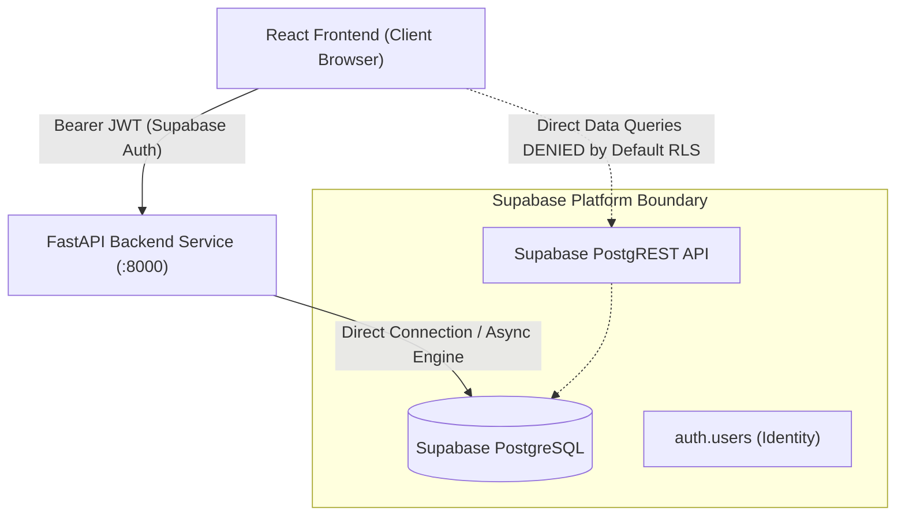
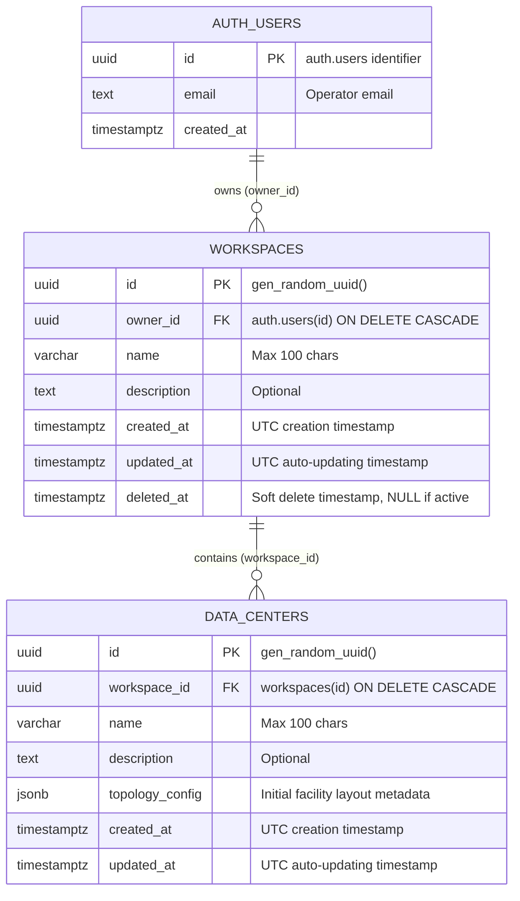

# DATAVERSE — Database Schema Specification

This document provides the authoritative architecture and schema specification for the PostgreSQL database underpinning the **DATAVERSE** 3D Living Data Center Simulator.

---

## 1. Architectural Overview & Security Invariants

DATAVERSE uses **Supabase PostgreSQL** for persistent multi-tenant workspace and infrastructure data storage, integrated with **Supabase Auth** for identity management.



### Security Invariants:

1. **FastAPI Exclusivity**: The FastAPI backend service is the **sole application-data access layer**. The frontend client never queries workspace or data center tables directly via Supabase PostgREST.
2. **Deny-by-Default Row Level Security (RLS)**: Both `workspaces` and `data_centers` have Row Level Security enabled with no permissive public policies. Anonymous and authenticated PostgREST queries from the browser are blocked at the database engine level.
3. **Secret Isolation**: Supabase service-role keys and database credentials reside exclusively in the backend server environment (`.env`). They are never exposed to the frontend or version control.
4. **Normalized Identifiers**: All primary and foreign keys utilize standard UUIDv4 (`gen_random_uuid()`). Hexadecimal simulation seeds and RFC 8785 canonical checksums follow the PRD v2.0 invariants.

---

## 2. Entity Relationship Diagram (ERD)



---

## 3. Schema Definitions

### 3.1. `public.workspaces`

Represents multi-tenant organization and project boundaries owned by authenticated operators.

| Column Name   | Data Type      | Nullable | Default                  | Description & Constraints                                                     |
| :------------ | :------------- | :------: | :----------------------- | :---------------------------------------------------------------------------- |
| `id`          | `UUID`         |    No    | `gen_random_uuid()`      | Primary Key. Unique identifier for the workspace.                             |
| `owner_id`    | `UUID`         |    No    | _None_                   | Foreign Key referencing `auth.users(id)` with `ON DELETE CASCADE`.            |
| `name`        | `VARCHAR(100)` |    No    | _None_                   | Workspace label. Checked: `length(trim(name)) > 0` and `length(name) <= 100`. |
| `description` | `TEXT`         |   Yes    | `NULL`                   | Optional operational notes or description.                                    |
| `created_at`  | `TIMESTAMPTZ`  |    No    | `timezone('utc', now())` | UTC creation timestamp.                                                       |
| `updated_at`  | `TIMESTAMPTZ`  |    No    | `timezone('utc', now())` | UTC timestamp maintained automatically via trigger.                           |
| `deleted_at`  | `TIMESTAMPTZ`  |   Yes    | `NULL`                   | Soft deletion marker. `NULL` denotes an active workspace.                     |

#### Constraints & Indexes:

- `workspaces_pkey`: Primary key constraint on `(id)`.
- `check_workspace_name_not_empty`: `CHECK (length(trim(name)) > 0)`.
- `check_workspace_name_max_length`: `CHECK (length(name) <= 100)`.
- `idx_workspaces_owner_id`: B-tree index on `(owner_id)` for high-performance operator lookup queries.
- `idx_workspaces_active`: Partial B-tree index on `(owner_id) WHERE deleted_at IS NULL` for active workspace listings.
- `idx_workspaces_owner_name_active`: Unique index on `(owner_id, lower(trim(name))) WHERE deleted_at IS NULL` ensuring an operator cannot provision duplicate active workspaces with the same normalized name.

---

### 3.2. `public.data_centers`

Represents physical data center facilities and 3D simulation environments belonging to a workspace.

| Column Name       | Data Type      | Nullable | Default                  | Description & Constraints                                                                |
| :---------------- | :------------- | :------: | :----------------------- | :--------------------------------------------------------------------------------------- |
| `id`              | `UUID`         |    No    | `gen_random_uuid()`      | Primary Key. Unique identifier for the facility.                                         |
| `workspace_id`    | `UUID`         |    No    | _None_                   | Foreign Key referencing `public.workspaces(id)` with `ON DELETE CASCADE`.                |
| `name`            | `VARCHAR(100)` |    No    | _None_                   | Facility label. Checked: `length(trim(name)) > 0` and `length(name) <= 100`.             |
| `description`     | `TEXT`         |   Yes    | `NULL`                   | Optional description or region specifications.                                           |
| `topology_config` | `JSONB`        |    No    | `'{}'::jsonb`            | Initial facility metadata (e.g. grid size, rack count). Constrained to JSON object type. |
| `created_at`      | `TIMESTAMPTZ`  |    No    | `timezone('utc', now())` | UTC creation timestamp.                                                                  |
| `updated_at`      | `TIMESTAMPTZ`  |    No    | `timezone('utc', now())` | UTC timestamp maintained automatically via trigger.                                      |

#### Constraints & Indexes:

- `data_centers_pkey`: Primary key constraint on `(id)`.
- `check_data_center_name_not_empty`: `CHECK (length(trim(name)) > 0)`.
- `check_data_center_name_max_length`: `CHECK (length(name) <= 100)`.
- `check_topology_config_is_object`: `CHECK (jsonb_typeof(topology_config) = 'object')`.
- `idx_data_centers_workspace_id`: B-tree index on `(workspace_id)` for cascade and workspace aggregation queries.
- `idx_data_centers_workspace_name`: Unique index on `(workspace_id, lower(trim(name)))` preventing duplicate facility names within the same workspace.
- `idx_data_centers_topology_config_gin`: GIN index on `(topology_config)` supporting expressive JSON path queries.

---

## 4. Trigger & Automation Functions

### `public.set_updated_at_timestamp()`

Maintains accurate UTC timestamps on record updates using `clock_timestamp()` to ensure strictly monotonic time progression:

```sql
CREATE OR REPLACE FUNCTION public.set_updated_at_timestamp()
RETURNS TRIGGER AS $$
BEGIN
    NEW.updated_at = timezone('utc'::text, clock_timestamp());
    RETURN NEW;
END;
$$ LANGUAGE plpgsql;
```

Attached triggers:

- `trigger_workspaces_set_updated_at`: `BEFORE UPDATE ON public.workspaces FOR EACH ROW EXECUTE FUNCTION public.set_updated_at_timestamp();`
- `trigger_data_centers_set_updated_at`: `BEFORE UPDATE ON public.data_centers FOR EACH ROW EXECUTE FUNCTION public.set_updated_at_timestamp();`

---

## 5. Row-Level Security (RLS) Strategy

Row-Level Security is enabled on all tables:

```sql
ALTER TABLE public.workspaces ENABLE ROW LEVEL SECURITY;
ALTER TABLE public.data_centers ENABLE ROW LEVEL SECURITY;
```

### Access Model:

- **Client (Frontend)**: Without permissive policies, any direct query via the Supabase client returns HTTP 401 / empty result sets.
- **Backend (FastAPI)**: Connects using the direct PostgreSQL database connection string (`DATABASE_URL`), bypassing client-side PostgREST restrictions.
- **Future Policy Roadmap**:
  When collaborative or realtime subscriptions are introduced in Day 3/4, explicit policies will be configured:
  ```sql
  -- Planned policy (to be implemented in Day 3 with workspace roles):
  CREATE POLICY "Operators can view workspaces they own"
      ON public.workspaces
      FOR SELECT
      TO authenticated
      USING (auth.uid() = owner_id AND deleted_at IS NULL);
  ```

---

## 6. Migration Application Instructions

The schema definition is housed in versioned migration:
`migrations/0001_initial_schema.sql`

> [!CAUTION]
> **Safety Guard**: This migration must **NOT** be applied to the live production Supabase instance without explicit approval.

### Option A: Via Supabase Studio (Recommended for Manual Review)

1. Navigate to the **Supabase Dashboard** for the project.
2. Open the **SQL Editor** from the left navigation pane.
3. Paste the contents of `migrations/0001_initial_schema.sql`.
4. Click **Run** to execute within an isolated transaction.
5. Verify in **Table Editor** that `workspaces` and `data_centers` appear with RLS enabled.

### Option B: Via Supabase CLI (Automated CI/CD)

```bash
# Link the project (requires access token)
supabase link --project-ref <project-id>

# Dry run / diff
supabase db diff

# Push migration to live database
supabase db push
```

### Option C: Direct `psql` Execution

```bash
psql "$DATABASE_URL" -f migrations/0001_initial_schema.sql
```

---

## 7. Remaining Security & Database Tasks (Roadmap)

- **Day 3 (Workspace & Tenancy Management)**:
  - Create `user_roles` or `workspace_members` table for team collaboration.
  - Implement FastAPI Pydantic schemas and CRUD repositories for workspaces.
  - Implement soft-delete cascade handling in repository layer.
- **Day 7–10 (Simulation Engine Core & Checkpoints)**:
  - Create `simulation_sessions`, `simulation_events`, and `simulation_checkpoints` tables.
  - Ensure canonical RFC 8785 JSON checksum validation for state snapshots.
